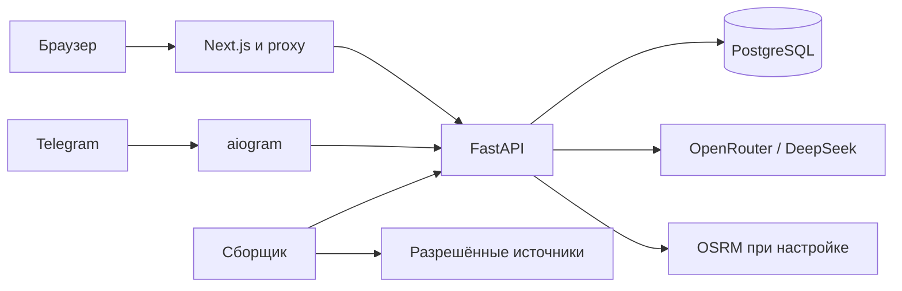

# Архитектура

Сервис состоит из веб-приложения Next.js, REST API FastAPI, Telegram-бота aiogram и сборщика источников. Все пользовательские поверхности обращаются к одному API и одному каталогу. Основная конфигурация развёртывания рассчитана на PostgreSQL, при локальной разработке доступен SQLite. Временный демонстрационный сервер сохраняет SQLite, как описано в паспорте экземпляра. Схему изменяют миграции Alembic в `apps/api/migrations`.

## Ответственность компонентов

| Каталог | Содержание |
|---|---|
| `apps/api/app` | Схемы, поиск, импорт, модерация, роли, подписки, обращения, агент, планировщик и проверка источников |
| `apps/api/migrations` | Последовательные миграции реляционной схемы |
| `apps/api/static/docs` | Локальные ресурсы Swagger UI, включая лицензии |
| `apps/web/src` | Публичные страницы, административный интерфейс и серверный proxy |
| `apps/web/public` | Используемые фотографии и шрифты |
| `apps/bot` | Меню, сообщения, карточки, пагинация и локальное состояние Telegram |
| `apps/worker` | Реестр источников, адаптеры, сбор и обслуживание данных |
| `tests` | Изолированные API/agent/source тесты и контрольный набор |
| `scripts` | Настройка, миграции, контракты, проверки и упаковка передачи |

## Достоверность данных

Исходный ответ источника сохраняется отдельно от нормализованной карточки с SHA256. Импорт идемпотентен и создаёт очередь проверки. Проверка источника и публикация выполняются через административный API. Отменённый сеанс исключается из подборок, но остаётся доступен по постоянной ссылке с пометкой. Пустая или оборванная выгрузка не считается доказательством массовой отмены.

Неизвестные цены, окончания, длительность, координаты и возраст сохраняются как `null`. Разные показы одной постановки имеют разные записи. UUID сеанса сохраняется при изменении данных поставщика, если поставщик передал устойчивый идентификатор. Все времена событий обрабатываются в `Asia/Yekaterinburg`, UTC+5.

## Агент и планировщик

LLM извлекает типизированные параметры, а исполнитель вызывает инструменты и повторно проверяет результат по каталогу. Модель не формирует фактические карточки и не получает адрес пользователя. Используются `search_events`, `get_event`, `find_similar`, `get_venue_schedule`, `subscribe`, `save_feedback`. Изменяющее действие требует серверного nonce и подтверждения. На ответ допускается не более пяти вызовов инструментов.

Планировщик детерминированно подбирает 2–4 события без пересечений. Проверяет верхнюю цену для всей группы, возраст, окно времени и известное окончание. Между разными площадками нужен подтверждаемый маршрут. Без координат или маршрутного сервиса время дороги остаётся неизвестным. Транспортные расходы, пробки, парковка и наличие билетов не обещаются.

Выбран модульный backend с отдельным веб-клиентом. Это позволяет боту, сайту и виджету использовать одинаковые правила. Единственный Node backend упрощал бы состав запуска, серверные шаблоны сокращали бы frontend-зависимости, но текущий вариант сохраняет независимый API и развитый интерфейс. Redis и отдельные микросервисы не требуются текущим процессам. Лимитер HTTP находится в памяти одного API-процесса, денежные квоты сохраняются в БД.
